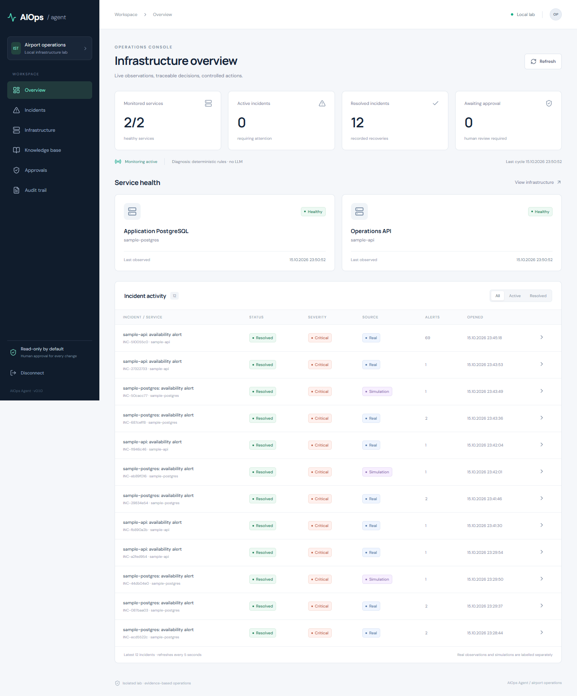

# AIOps Agent

[](https://github.com/ShaNuva66/aiops-agent/actions/workflows/ci.yml)

Evidence-based IT operations and controlled troubleshooting in a local Linux container lab.
The fictional airport company supplies the business setting; health checks, PostgreSQL
outages, incident persistence and approved HTTP fault recovery use real services.

**Status:** working local MVP. Default diagnosis is deterministic (`rules`), explicitly
labelled as **not AI inference**. An optional OpenAI Agents SDK adapter is included;
one live HTTP-fault case has been completed with gpt-4o-mini, while broad model quality
remains unverified. See [test results](docs/TEST_RESULTS.md).

## See an actual AI-assisted case

The default homepage is **AIOps Observatory**, a read-only visual operations story.
It combines an animated system map, six-stage incident replay, employee impact,
separate monitoring/AI/operator responsibilities, the original AI report and evidence.
Use **Sade anlatım / Teknik görünüm** to switch detail levels, **Hareket açık/kapalı**
to control animation, and **Vaka kaydını indir** to download the original sanitized case.
Reduced-motion preferences are respected. Playback never sends a command or model request.
The shared palette combines deep navy, slate, cyan, blue and amber across the presentation,
sign-in screen and operations console. Slow ambient light, one-time card entrances and
button feedback complement a soft mouse halo and local card spotlight. The native cursor
is retained; the halo hides over form fields, during keyboard navigation and on touch devices.
Reading text and orbit labels remain stationary. The motion preference persists across
reloads and routes; disabling it stops effects and keeps every section visible. Operating
system reduced-motion preferences also disable effects and pause presentation playback.
Page backgrounds, cards, expanded evidence and native controls use coordinated dark surfaces
with light copy; there is no white page canvas.

The authenticated operations console remains at **http://127.0.0.1:8080/?dashboard=1**.
Preview: [desktop](docs/images/spectrum-desktop.png) ·
[AI report](docs/images/spectrum-ai.png) · [phone](docs/images/spectrum-mobile.png) ·
[sign-in](docs/images/spectrum-login.png) · [operations console](docs/images/spectrum-operator.png).
The console preview uses a separate private test fixture with labelled simulation incidents.

Open **http://127.0.0.1:8080/?case=1** after starting the frontend. This read-only page
shows the recorded real HTTP 500 → model tools/findings → operator-authorized fixed
recovery → HTTP 200 → monitored closure. It requires no login or new model call.
The case ran on Windows with isolated SQLite storage, not Docker/PostgreSQL. The model
recommended checks; an explicitly user-authorized test harness approved and executed the
fixed runbook. It was not autonomous model authorization or a general repair agent.
To explicitly repeat this paid API experiment: `.venv/Scripts/python -m scripts.live_ai_case`.
The script uses private .env credentials and exports only the redacted successful case.
For a standalone local case preview without Docker: run `npm run build` and
`npm exec -- vite preview --host 127.0.0.1 --port 8080` inside `frontend/`, then open
`http://127.0.0.1:8080/?case=1`. This serves the recorded case only; authenticated live
operations still require the backend/lab deployment.

## Quick start — Windows PowerShell

Prerequisites: Docker Desktop with a working Linux engine / WSL 2, Git, and Python 3.12+
with [uv](https://docs.astral.sh/uv/). Node is only needed for frontend development.

```powershell
git clone https://github.com/ShaNuva66/aiops-agent.git
cd aiops-agent
uv sync --frozen
uv run python scripts/init_env.py
docker compose up -d --build --wait
```

Open **http://127.0.0.1:8080** for the visual presentation, or
**http://127.0.0.1:8080/?dashboard=1** for operations. On the first operator visit, create your username and password
(at least 8 characters) using **Hesap oluştur ve giriş yap**. Later visits show the normal
**Giriş yap** screen. Select **Beni hatırla** to keep the session for up to 30 days;
otherwise the browser cookie is session-only and server access expires after 8 hours.
**Çıkış yap** revokes the session on the server. No API token is needed in the dashboard.

The local deployment has one operator account. The first-account form closes once that
account exists. Passwords are salted scrypt hashes; sessions use HttpOnly cookies rather
than browser-readable stored API keys. Do not share `.env` or browser authentication dumps.

Screens: [first account](docs/images/account-setup.png) · [sign in](docs/images/login.png).

The dashboard uses Turkish labels and opens with **Açıklamaları göster** enabled.
The overview starts with a visual **Bir arıza nasıl oluşur, nasıl çözülür?** player.
Choose the HTTP failure or database-stop scenario, then use **Oynat** or **Sonraki adım**
to follow the changing service diagram, response and operator action. It is an explicitly
labelled educational simulation and sends no fault or recovery commands.
Actual incident pages separately show **Önce → Hata → Tespit → İşlem → Sonuç** from
stored observations and scoped audit records. Manual closure is distinguished from monitored
recovery; a missing root cause or intervention record is left unknown.
Each screen explains what is checked, why it matters and how to read the result.
Start with **Genel durum → Servisi kontrol et**, then follow an incident and its evidence.
**Bu terimler ne demek?** explains terms such as API, PostgreSQL, logs and health checks.
Raw evidence, original reports and source documents remain available in expandable sections.
Knowledge search accepts common Turkish keywords such as **veritabanı erişim** using a
fixed keyword mapping, not semantic translation or AI inference.
Reviewed learning-mode screenshots use an isolated UI fixture with explicitly labelled
simulation incidents: [desktop](docs/images/learning-overview.png) · [mobile](docs/images/learning-mobile.png).

API documentation: http://127.0.0.1:8000/api/docs. Use **Authorize** with `API_TOKEN`.
Programmatic operator access still uses `API_TOKEN`; ingestion uses `INGEST_TOKEN`.



```powershell
docker compose ps
docker compose logs --tail 50 backend
docker compose stop
docker compose start
```

`stop` preserves PostgreSQL volumes. Ordinary `docker compose down` also preserves volumes.
Do not add `-v` unless you intentionally want to erase lab and incident data.

## Try a real outage

```powershell
docker compose stop lab-db
# Watch sample-postgres become down and an incident open in the dashboard.
docker compose start lab-db
# Watch recovery resolve the incident; its evidence and report remain available.
```

The control database is separate from `lab-db`. With the default 5-second interval and
two failed observations, detection usually takes several seconds; network timeouts and
an in-progress diagnosis can extend this. Availability failure alone does not prove root cause.

For controlled HTTP faults, use `uv run python scripts/lab_fault.py http500`.
Recovery can be performed by a human using `uv run python scripts/lab_fault.py none`,
or through an approved runbook after explicitly enabling execution below.

## Human-approved recovery

Default `ENABLE_LAB_EXECUTION=false` prevents all runbook execution. To opt in locally:
set it to `true` in `.env`, then run `docker compose up -d --wait`.

1. Inject `http500` with the script above.
2. Open the real `sample-api` availability incident.
3. Request human approval for `clear-http-fault:v1`.
4. In Approvals, review the exact target and parameters, then approve or reject.
5. A separate Execute action consumes the approval before contacting the test API.
6. The executor checks the precondition, clears the injected fault and verifies readiness.

Only this runbook exists. It is not a generic service restarter, shell, network administrator,
or database cleanup tool. An approved attempt cannot be reused, including after failure.

## Optional AI diagnosis

In `.env`, set `DIAGNOSIS_PROVIDER=openai`, `OPENAI_API_KEY` and an explicitly chosen
`OPENAI_MODEL` that supports tools and structured outputs. Recreate the backend:

```powershell
docker compose up -d --wait
```

The agent receives only bounded, redacted evidence for its assigned incident and retrieved
knowledge. Tool budget: 8 calls; turn limit: 5; run timeout: 90 seconds. Tracing is disabled
to avoid sending telemetry to an additional tracing service. Evidence/document identifiers
are validated after generation. This does **not** guarantee the model interprets evidence
correctly. Real provider inference may incur charges; it is never required for offline tests.

## Knowledge retrieval

The default mode searches saved runbooks and resolved incidents with lexical overlap.
An optional Qdrant profile stores deterministic hashed word vectors. This is a real vector
index but **not semantic embedding retrieval**; collisions and vocabulary mismatch are
known limits. Set `QDRANT_URL=http://qdrant:6333` in `.env`, then:

```powershell
docker compose --profile knowledge up -d --wait
docker compose exec -T backend python -m scripts.verify_qdrant
```

Documents retain stable source IDs and content revisions. Historical documents support
recommendations; they are not observations of the current failure.

## Development and verification

```powershell
uv sync --frozen
uv run alembic upgrade head
uv run alembic check
uv run pytest -q --cov=backend --cov-report=term-missing
uv run ruff check .
uv run ruff format --check .
npm.cmd ci --prefix frontend
npm.cmd run build --prefix frontend
```

The host development default uses SQLite, explicitly separate from Docker's PostgreSQL.
For local development, run `uv run uvicorn backend.main:create_app --factory --port 8000`
and `npm.cmd run dev --prefix frontend`. Stop the Docker backend first to free port 8000.
The sample lab may remain in Docker. Apply migrations before starting the host backend.

Real Docker acceptance suite (**deliberately stops this project's `lab-db`**):

```powershell
docker compose -f docker-compose.yml -f infrastructure/compose.test.yml up -d --wait
uv run python scripts/e2e_lab.py
docker compose up -d --wait
```

The last command restores base read-only configuration. Test artifacts are private/ignored
under `artifacts/`; the sanitized summary is committed under `docs/TEST_RESULTS.md`.

## Repository map

| Directory | Responsibility |
|---|---|
| `backend/` | API, monitoring, incident logic, SDK adapter, retrieval, approval/executor |
| `frontend/` | React + TypeScript operations console |
| `infrastructure/` | Container build, real sample service, test overrides |
| `migrations/` | Explicit Alembic schema history |
| `knowledge-base/` | Versioned troubleshooting references |
| `monitoring/` | External monitoring integration contract |
| `runbooks/` | Executable action definition and operating procedure |
| `scripts/` | Private environment generation, faults, acceptance tests |
| `tests/` | API, logic, authorization, SDK contract and retrieval tests |
| `docs/` | Architecture, security, progress, decisions and portfolio materials |

## Limits

Local single-operator, single-backend-process lab only. CPU is process CPU, memory is
Linux VM-visible memory, disk is the container filesystem; none are Windows host metrics.
The collector observes database connectivity, not PostgreSQL's internal container logs.
Audit records are application append-only; a database administrator can alter them.
Retention/archiving, full RBAC, TLS, distributed workers, Zabbix deployment, semantic
embeddings, Windows Server and Active Directory are future work, not completed features.

Read [architecture](docs/ARCHITECTURE.md), [security](docs/SECURITY.md),
[roadmap](docs/ROADMAP.md), and [current progress](docs/PROGRESS.md) before extending the system.
