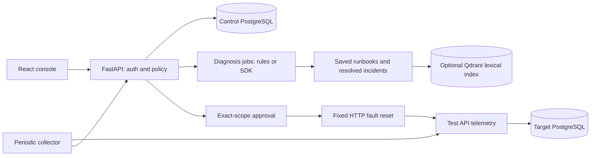

# Architecture

## Deployment
A modular Python monolith with a single-process FastAPI API and background operations cycle.
The cycle invokes deterministic collection and processes one durable diagnosis job at a time.
React is served by an unprivileged Nginx process, which proxies /api to FastAPI.

Browser access uses a single operator account and server-side revocable sessions in PostgreSQL.
First-use setup is atomic; passwords are scrypt hashes. HttpOnly cookies carry opaque random
session identifiers; CSRF tokens stay in memory and are restored through /api/auth/me.
Programmatic API tokens remain separate from browser login. See SECURITY.md for cookie lifetimes.

## Failure boundaries
control-db persists the platform; lab-db is the deliberately stoppable application dependency.
No database ports are published. UI/API/lab ports bind only to 127.0.0.1. A missing lab
observer marks database status unknown rather than inventing a database outage.

The sample-api service status describes its own fault/live state. Its /health/ready also
checks its database dependency and can return 503 while the API process remains available.
Database dependency health has its own sample-postgres service and incident.

## Collection and incident lifecycle
Default polling: 5 seconds; availability alarm after 2 failed observations; recovery after
one healthy observation. CPU/memory/disk use deterministic >=90% thresholds, without
availability debounce. The cycle is fixed-delay and processes diagnosis after collection;
slow probes or inference extend the next collection time. This is a measured lab limitation.

Events have a source/event_id uniqueness constraint. Active incidents have one unique,
nullable active_key combining data kind, asset, service and check. PostgreSQL row locks
and per-correlation PostgreSQL transaction advisory locks protect correlation, including
problem/recovery races without an existing row. Retry on uniqueness races protects delivery
across correlation keys. Reusing an event ID with different content is rejected.
Older/equal-timestamp events are stored
but do not change incident state. Recovery clears active_key; recurrence opens a new incident.

Lifecycle: open -> investigating -> resolved; monitoring can resolve open/investigating.
Resolved incidents are immutable through the public API. Operators can manually resolve
with an audit note; continued failures can create a new incident. Automatic recovery is
a health observation, not a proven root-cause explanation.

## Data model
Asset 1:N Service; Service 1:N Incident; Incident 1:N MonitoringEvent, Evidence,
DiagnosisRun, Approval. KnowledgeDocument contains versioned runbooks and resolved incident
summaries. AuditEvent records security-relevant transitions and tool calls. All IDs are
server-generated UUIDs except allowlisted inventory and stable document IDs.

## Diagnosis and retrieval
Initial event evidence is preserved; repeated raw events remain in monitoring_events.
Diagnosis adds a fresh bounded telemetry snapshot for real incidents only. The OpenAI
adapter exposes read-only tools bound to the incident by closure, no arbitrary target input.
Structured findings must cite actual evidence IDs; source IDs must come from retrieval.
Reference validity is enforced, semantic correctness is not guaranteed.

Rules mode makes observations and explicitly declines unsupported root-cause conclusions.
SQLite is a portable development/test backend; real integration tests exercise PostgreSQL.
Qdrant retrieval uses 512-dimensional SHA-256 word feature hashing with cosine similarity
and an exact lexical overlap filter. It is not a learned semantic embedding model.
Search results reserve a matching runbook and a matching incident when both exist, so
repeated incident summaries cannot crowd out all runbooks. Equal scores prefer newer
resolved incidents. Qdrant also queries the runbook category separately for this purpose.

## Restart and scaling
Queued diagnoses persist. Interrupted running diagnoses become failed; operators can retry.
Executing approvals become failed/uncertain after restart and are never replayed. No guarantee
of exactly-once external effects after a process crash; at-most-one initiated attempt per
approval is the intended property. Verify the target before requesting a new action.

Run exactly one Uvicorn worker. Multiple API instances would require external scheduling,
leases, worker ownership and restart reconciliation redesign.
